<picture>
  <source media="(prefers-color-scheme: dark)" srcset="assets/banner-dark.svg">
  <source media="(prefers-color-scheme: light)" srcset="assets/banner-light.svg">
  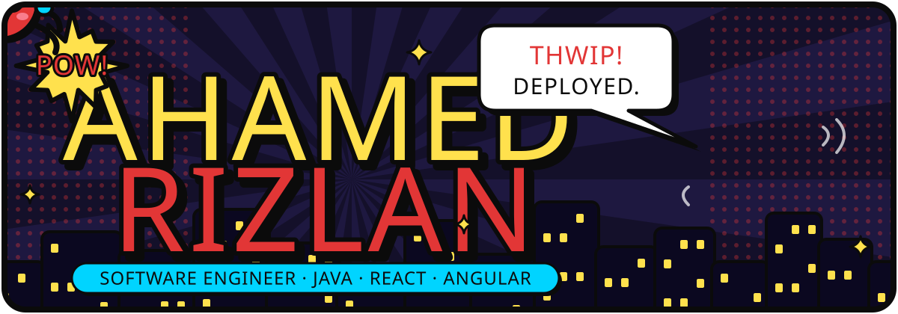
</picture>

<p align="center">
  <picture>
    <source media="(prefers-color-scheme: dark)" srcset="https://readme-typing-svg.demolab.com?font=Fira+Code&weight=500&size=20&duration=2800&pause=900&color=FF6B6B&center=true&vCenter=true&width=640&lines=%3E+miles.init()%3B;Software+engineer+from+Sri+Lanka;Java+%2B+Spring+Boot;React+%2B+Angular;Every+language+teaches+me+something+new.">
    
  </picture>
</p>


```js
const rizlan = {
  role:      "Software engineer, web-slinger on weekends",
  basedIn:   "Sri Lanka, Earth-1610 edition",
  building:  ["web apps", "automation frameworks", "game AI"],
  learning:  "whatever the world throws at me next",
  offline:   ["smashing boundaries on the cricket pitch", "music on full volume"],
  motto:     "I'm gonna do my own thing.",
};
```

<picture>
  <source media="(prefers-color-scheme: dark)" srcset="assets/divider-dark.svg">
  
</picture>


<p align="center">
  <picture>
    <source media="(prefers-color-scheme: dark)" srcset="https://skillicons.dev/icons?i=java%2Cspring%2Cjs%2Cts%2Creact%2Cangular%2Cnextjs%2Chtml%2Ccss%2Ctailwind%2Cpython%2Ccs%2Cunity%2Cpostgres%2Cgit%2Cvercel&theme=dark&perline=8">
    
  </picture>
</p>


<p align="center">
  <picture>
    <source media="(prefers-color-scheme: dark)" srcset="https://raw.githubusercontent.com/Ahd-Rizlan/Ahd-Rizlan/output/stats-dark.svg">
    
  </picture>
  <picture>
    <source media="(prefers-color-scheme: dark)" srcset="https://raw.githubusercontent.com/Ahd-Rizlan/Ahd-Rizlan/output/langs-dark.svg">
    
  </picture>
</p>
<p align="center">
  <picture>
    <source media="(prefers-color-scheme: dark)" srcset="https://streak-stats.demolab.com?user=Ahd-Rizlan&background=1C1418&border=0B0B0B&ring=E23636&fire=FFE14D&currStreakNum=FFFFFF&sideNums=FFE14D&currStreakLabel=00D4FF&sideLabels=FFFFFF&dates=C9B9BE&stroke=0B0B0B&border_radius=22">
    
  </picture>
</p>

<picture>
  <source media="(prefers-color-scheme: dark)" srcset="assets/divider-dark.svg">
  
</picture>


<p align="center">
  <a href="https://github.com/Pacto-Code"><picture><source media="(prefers-color-scheme: dark)" srcset="assets/teams/Pacto-Code-dark.svg">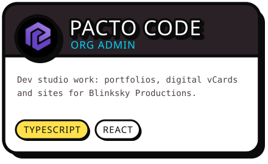</picture></a>
  <a href="https://github.com/SGDP-group"><picture><source media="(prefers-color-scheme: dark)" srcset="assets/teams/SGDP-group-dark.svg">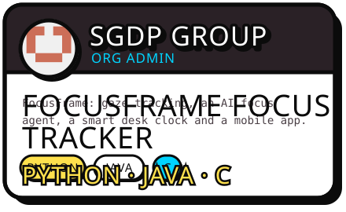</picture></a>
  <a href="https://github.com/AssuraSolutions"><picture><source media="(prefers-color-scheme: dark)" srcset="assets/teams/AssuraSolutions-dark.svg">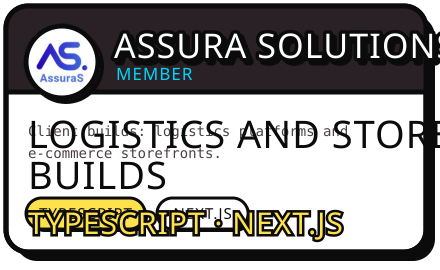</picture></a>
</p>

<picture>
  <source media="(prefers-color-scheme: dark)" srcset="assets/divider-dark.svg">
  
</picture>


<p align="center">
  <a href="https://github.com/Ahd-Rizlan/Ember-Js"><picture><source media="(prefers-color-scheme: dark)" srcset="assets/cards/01-dark.svg">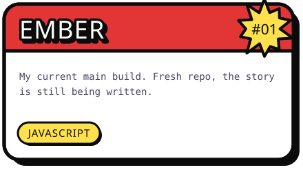</picture></a>
  <a href="https://github.com/Ahd-Rizlan/Web-Automations"><picture><source media="(prefers-color-scheme: dark)" srcset="assets/cards/02-dark.svg">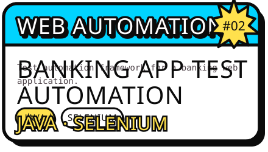</picture></a>
  <a href="https://github.com/Ahd-Rizlan/ticketing-system-angular"><picture><source media="(prefers-color-scheme: dark)" srcset="assets/cards/03-dark.svg">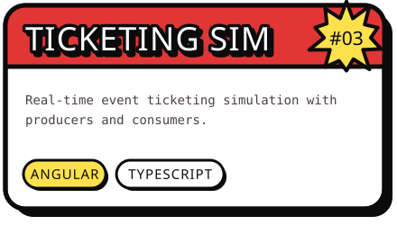</picture></a>
  <a href="https://github.com/Ahd-Rizlan/game-ai-unity"><picture><source media="(prefers-color-scheme: dark)" srcset="assets/cards/04-dark.svg">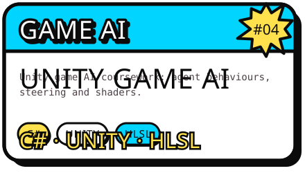</picture></a>
  <a href="https://github.com/Ahd-Rizlan/Machine-Learning"><picture><source media="(prefers-color-scheme: dark)" srcset="assets/cards/05-dark.svg">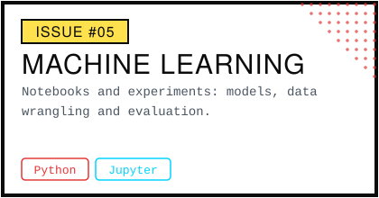</picture></a>
  <a href="https://github.com/Ahd-Rizlan/property-finder-react"><picture><source media="(prefers-color-scheme: dark)" srcset="assets/cards/06-dark.svg">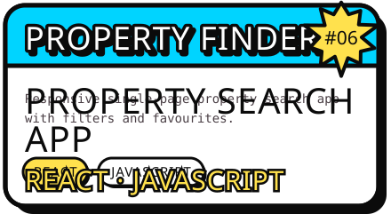</picture></a>
</p>


<p align="center">
  <a href="https://influencerhub-psi.vercel.app"><picture><source media="(prefers-color-scheme: dark)" srcset="assets/cards/07-dark.svg">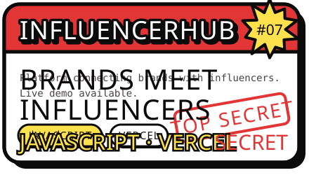</picture></a>
  <picture><source media="(prefers-color-scheme: dark)" srcset="assets/cards/08-dark.svg">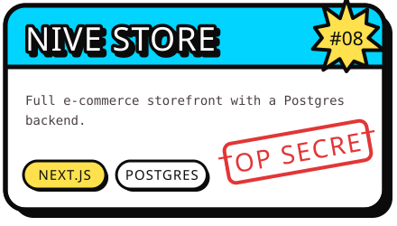</picture>
</p>


<picture>
  <source media="(prefers-color-scheme: dark)" srcset="https://raw.githubusercontent.com/Ahd-Rizlan/Ahd-Rizlan/output/spider-dark.svg">
  
</picture>

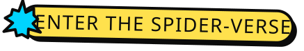

<p align="center">
  <picture><source media="(prefers-color-scheme: dark)" srcset="assets/facts/01-dark.svg">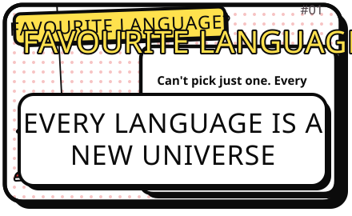</picture>
  <picture><source media="(prefers-color-scheme: dark)" srcset="assets/facts/02-dark.svg">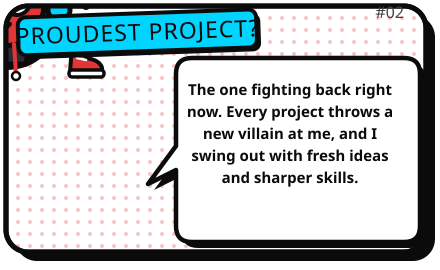</picture>
  <picture><source media="(prefers-color-scheme: dark)" srcset="assets/facts/03-dark.svg">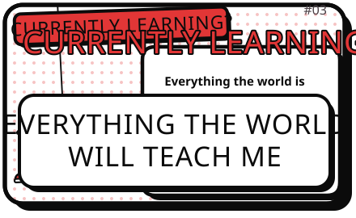</picture>
  <picture><source media="(prefers-color-scheme: dark)" srcset="assets/facts/04-dark.svg">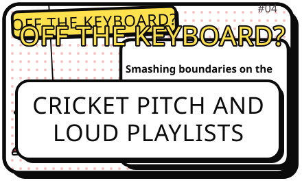</picture>
  <picture><source media="(prefers-color-scheme: dark)" srcset="assets/facts/05-dark.svg">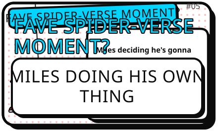</picture>
</p>


<p>
  <a href="https://github.com/Ahd-Rizlan"></a>
  <!-- Add more once you share them, e.g. LinkedIn:
  <a href="https://www.linkedin.com/in/YOUR-HANDLE"></a>
  -->
</p>

<sub>Original artwork inspired by the Spider-Verse look. Not affiliated with Marvel or Sony. Comic lettering: <a href="https://github.com/googlefonts/bangers">Bangers</a> (SIL Open Font License).</sub>
